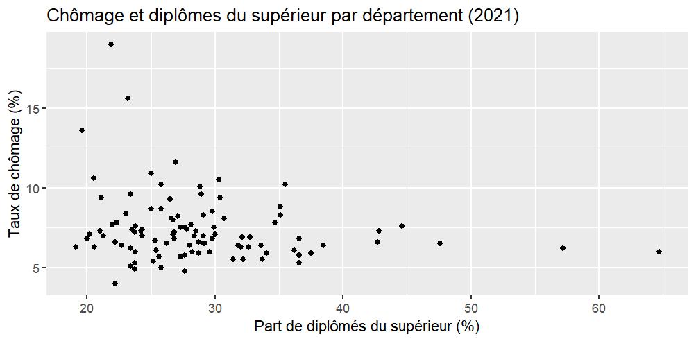

# Déterminants du chômage départemental en France

Projet d'économétrie — M1 Économie Appliquée, parcours SciDE, Université de Lille

Auteure : Sylvia Corinne Yovogan

## Question de recherche

Quels facteurs expliquent les écarts de taux de chômage entre les départements français ?

## Données

| Variable | Source | Année |
|---|---|---|
| Taux de chômage | INSEE | 2021 (T4) |
| Part de diplômés du supérieur | Observatoire des Territoires (INSEE) | 2021 |
| Part des 18-24 ans dans la population | Observatoire des Territoires (INSEE) | 2022 |
| Part de l'emploi industriel | Observatoire des Territoires (INSEE) | 2022 |

Les variables issues du recensement (diplômes, jeunes, industrie) ne sont pas toutes disponibles pour la même année exacte. L'année la plus récente disponible a été retenue pour chacune : le taux de chômage et les diplômes datent de 2021, la part des jeunes et l'emploi industriel du dernier recensement disponible (2022).

**Graphique exploratoire** : chômage et diplômés du supérieur par département (échantillon de 100 départements, 2021).



*Lecture : chaque point représente un département. Plus la part de diplômés est élevée, plus le chômage tend à être bas, mais avec beaucoup de variations. Les points isolés en haut à gauche sont des départements d'outre-mer, qui ne sont pas dans le modèle final présenté plus bas.*

## Méthode

Une régression linéaire multiple (MCO) est estimée sur les départements français :

taux_chomage = β₀ + β₁·diplômes + β₂·jeunes_18_24 + β₃·emploi_industriel + ε

Deux versions du modèle sont présentées :
- **Modèle complet** (100 départements, DOM inclus)
- **Modèle final** (96 départements, France métropolitaine uniquement)

Les départements d'outre-mer présents dans l'échantillon (Guadeloupe, Martinique, Guyane, La Réunion) ont été exclus du modèle final. L'analyse des valeurs influentes (distance de Cook) avait notamment mis en évidence la Guadeloupe et La Réunion comme particulièrement atypiques. Par cohérence méthodologique, l'ensemble des DOM a été retiré, puisque ces territoires présentent des structures économiques et des marchés du travail substantiellement différents de la France métropolitaine.

## Résultats (modèle final, France métropolitaine)

| Variable | Coefficient | Significativité |
|---|---|---|
| Part de diplômés du supérieur | -0,094 | *** |
| Part des 18-24 ans | +0,229 | * |
| Part de l'emploi industriel | -0,151 | ** |

*Significativité calculée avec des erreurs-types robustes (HC1). Seuils : trois étoiles = p < 0,001 ; deux étoiles = p < 0,01 ; une étoile = p < 0,05.*

*R² = 0,18 — le modèle explique 18 % de la variation du taux de chômage entre départements métropolitains.*

**Lecture des résultats** (toutes choses égales par ailleurs) :
- Une hausse d'1 point de la part de diplômés du supérieur est associée à une baisse de 0,09 point du taux de chômage.
- Une hausse d'1 point de la part des 18-24 ans est associée à une hausse de 0,23 point du taux de chômage.
- Une hausse d'1 point de la part de l'emploi industriel est associée à une baisse de 0,15 point du taux de chômage.

Ces résultats sont cohérents avec la littérature économique : un niveau de diplôme plus élevé facilite l'insertion professionnelle ; les jeunes actifs sont structurellement plus exposés au chômage ; et l'emploi industriel est associé à des bassins d'emploi plus stables dans certains territoires.

## Validité du modèle

- **Hétéroscédasticité** : détectée sur le modèle complet (test de Breusch-Pagan, p = 0,0007) et sur le modèle final (p = 0,0007). Des erreurs-types robustes (HC1) ont été utilisées dans les deux cas. Les variables restent statistiquement significatives après correction.
- **Multicolinéarité** : aucun problème détecté (VIF < 2 pour les trois variables du modèle final).
- **Valeurs influentes** : la Guadeloupe et La Réunion ont été identifiées comme atypiques (distance de Cook) ; l'ensemble des départements d'outre-mer présents dans l'échantillon (Guadeloupe, Martinique, Guyane, La Réunion) a ensuite été exclu du modèle final, par cohérence méthodologique.

## Limites

- Ce modèle met en évidence des **associations statistiques**, et non des relations de causalité.
- Seules 3 variables sont incluses : d'autres facteurs (conjoncture locale, histoire économique du territoire, etc.) influencent très probablement le chômage départemental et ne sont pas captés ici (R² = 0,18).
- Les données ne couvrent pas toutes exactement la même année (2021-2022), par contrainte de disponibilité des sources.

## Structure du dépôt

```
├── analyse.R                          # Script R complet (import, nettoyage, régression, diagnostics)
├── chomage-departements-france.Rproj  # Projet RStudio
├── data/                              # Données sources (INSEE, Observatoire des Territoires) et graphique
└── README.md
```

## Reproduire l'analyse

1. Ouvrir le fichier `chomage-departements-france.Rproj` dans RStudio
2. Installer les packages si besoin : `install.packages(c("tidyverse", "readxl", "lmtest", "sandwich", "car"))`
3. Exécuter `analyse.R`
